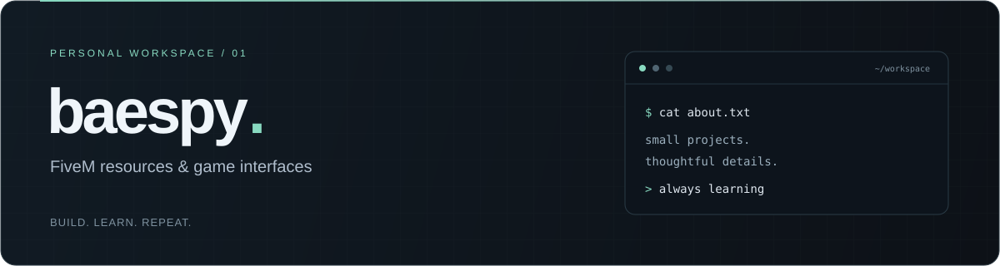

<p align="center">
  
</p>

<p align="center">
  I work on FiveM resources and the interfaces around them.<br />
  Learning through small projects, experiments, and everyday fixes.
</p>

<p align="center">
  <a href="#about">About</a> &nbsp; · &nbsp;
  <a href="#toolbox">Toolbox</a> &nbsp; · &nbsp;
  <a href="#project">Project</a>
</p>

<br />

### About

```text
baespy ~ $
│
├── focus       FiveM resources & game interfaces
├── enjoy       clean menus, small details, useful tools
└── approach    build → try → learn → improve
```

I like turning ideas into something I can actually use — a gameplay feature,
a clearer menu, or a small tool that makes working on a server easier.

<br />

### Toolbox

<sub>Languages I work with</sub>

<p>
  
  
  
  
</p>

<sub>For interfaces</sub>

<p>
  
  
  
  
</p>

<br />

### Project

| &nbsp; | &nbsp; |
| :--- | :--- |
| **[infrontofx-skill ↗](https://github.com/baespy/infrontofx-skill)** | Conventions, references, and templates for working on FiveM Lua and NUI/DUI with coding agents. |
| **Focus** | A consistent starting point for resources and interfaces. |
| **[infrontofx-fivem ↗](https://github.com/baespy/infrontofx-fivem)** | A local FiveM MCP and realtime telemetry tools built around the same conventions. Currently a development release. |

<br />

<hr />

<p align="center">
  <sub>A little better with every project.</sub>
</p>
