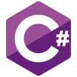

<h1 align="center">baespy</h1>

  FiveM resources · Game interfaces · Useful tools

  <a href="#about">About</a> &nbsp; · &nbsp;
  <a href="#experience">Experience</a> &nbsp; · &nbsp;
  <a href="#tools--languages">Tools &amp; Languages</a> &nbsp; · &nbsp;
  <a href="#projects">Projects</a>

## About

I build and improve FiveM resources, game interfaces, and tools for everyday use.
I enjoy building useful features and tools, understanding existing code, and
working through problems that show up in everyday use.

I'm still learning. My approach is to understand the problem, try a change,
check the result, and improve from there.

## Experience

- **FiveM development** — Worked on servers with 1,000+ players, developing
  and improving Lua resources and their server-side logic.
- **Performance & debugging** — Reduced resource usage measured through resmon
  and worked on model-related memory leaks, including how resources load and
  release models.
- **Data & hosting** — Used MySQL and MongoDB for application data, and Nginx
  for serving websites and setting up reverse proxies.

## Tools & Languages

Tools I use across projects, with FiveM and Lua as my main focus.

**Languages & scripting**

  
  &nbsp;
  
  &nbsp;
  
  &nbsp;
  

**Databases**

  
  &nbsp;
  

**Web & game interfaces**

  
  &nbsp;
  
  &nbsp;
  
  &nbsp;
  
  &nbsp;
  
  &nbsp;
  
  &nbsp;
  

**Web serving & proxying**

  

## Projects

### [infrontofx-skill ↗](https://github.com/baespy/infrontofx-skill)

Development conventions, references, and templates for FiveM Lua resources
and NUI/DUI interfaces. A place to organize practical guidance for working
with coding agents and keep improving it as I learn.

### [infrontofx-fivem ↗](https://github.com/baespy/infrontofx-fivem)

Tools for writing, debugging, and reviewing FiveM resources, connected to
infrontofx-skill. Currently a development release, growing through practical
use and ongoing improvements.

---

  Build → try → learn → improve.

